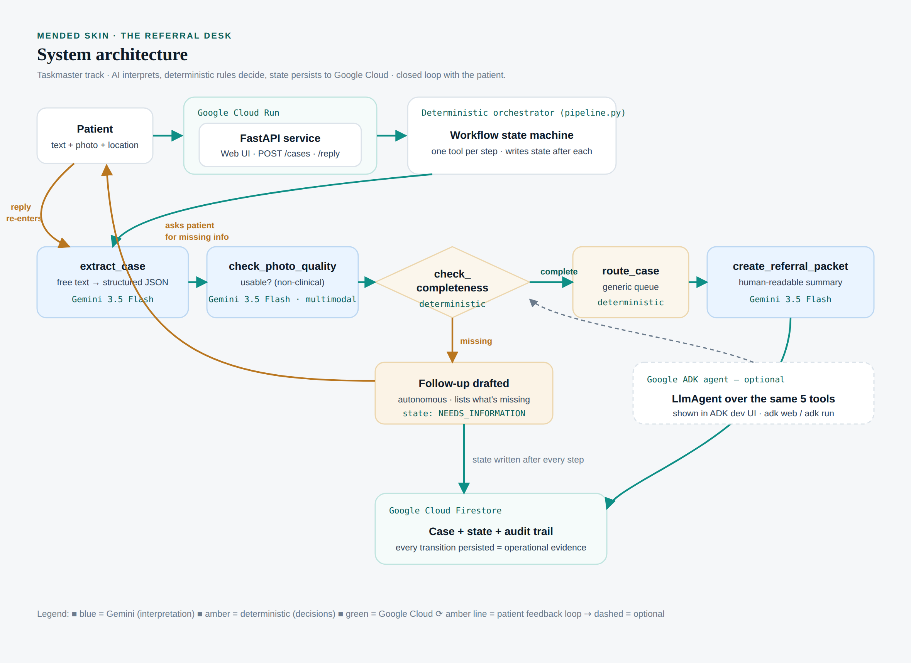

# The Referral Desk

**Turns a patient's scar-care enquiry into a referral-ready case.**

A next-generation, autonomous agent for the **All Things Agentic Hackathon**
(Taskmaster track). It takes an unstructured patient enquiry — free text, an
optional photo, a location — and runs a complete operational workflow: it
structures the information with Gemini, checks the photo is usable, decides
deterministically whether the case is complete, routes it to the right
administrative queue, generates a referral packet, and persists every state
transition to Google Cloud. When information is missing, it autonomously drafts
a follow-up and pauses — and when the patient replies, it merges the new details
and carries the case through to referral without starting over.

It is a **workflow, not a chatbot**. The language model never controls the
sequence or the decisions — it only interprets.

> **Prototype scope.** This is a standalone hackathon prototype built from
> scratch with **synthetic data** and simplified demonstration rules. It does
> **not** contain Mended Skin's production matching, clinical decision-support,
> provider-selection, or proprietary data models. See
> [Prototype scope / IP boundary](#prototype-scope--ip-boundary).

---

## What it does (demo workflow)

```
TEXT (+ optional photo, location)
        │
        ▼
  extract_case          Gemini 3.5 Flash → structured intake JSON
        │
        ▼
  check_photo_quality   Gemini 3.5 Flash (multimodal) → USABLE / RETAKE (non-clinical)
        │
        ▼
  check_completeness    deterministic gate → ready? what's missing?
        │
     ┌──┴───────────────┐
     ▼                  ▼
 NEEDS_INFORMATION   route_case (deterministic) → generic queue
 auto follow-up          │
     │  ▲                ▼
     │  │          create_referral_packet   Gemini 3.5 Flash → summary
     │  │                │
     ▼  │                ▼
 patient reply ──┘  Firestore: case + state + audit trail
 (POST /cases/{id}/reply → merge → re-process)
```

The loop is closed: an incomplete case pauses at `NEEDS_INFORMATION` with an
autonomous follow-up; when the patient replies, the case merges the new
information and re-runs from extraction until it reaches `REFERRAL_READY`.

Workflow states: `NEW → EXTRACTED → IMAGE_CHECKED → COMPLETENESS_CHECKED →
(NEEDS_INFORMATION ⇄ patient reply | REFERRAL_READY) → ROUTED → HANDED_OFF`,
plus an explicit `FAILED` state.

Once a case is routed, an **availability-only front-office handoff** shortlists
clinics currently accepting enquiries and records a simulated notification to
each (no real message is sent). This is deliberately availability-only — there
is no scar-type or provider-matching logic, which stays in the private
production system.

---

## Architecture



| Layer | Choice | Why |
|---|---|---|
| Reasoning | **Gemini 3.5 Flash** (via GenAI SDK, or Vertex AI) | interpretation: extraction, image usability, summary |
| Agent framework | **Google GenAI SDK** (required) + **Google ADK** (optional) | GenAI SDK powers the pipeline; ADK agent wraps the same tools |
| Orchestration | **Deterministic pipeline** (`app/pipeline.py`) | reliable, auditable workflow control — rules, not the LLM |
| State / memory | **Google Cloud Firestore** | persistent case state + full audit trail |
| Hosting | **Google Cloud Run** | containerised FastAPI service |
| Secrets | **environment variables only** | no keys in the repo (`.gitignore`d) |

**Design principle: AI interprets · deterministic rules decide · clinicians
retain care.** Gemini understands and summarises; Python owns required-field
checks, workflow state, and routing; no diagnosis, grading or treatment advice
is ever produced.

**Robustness.** Every Gemini call is wrapped with graceful degradation and the
whole workflow has a `MOCK_MODE` that runs offline with deterministic stand-ins,
so a live demo cannot be broken by a network hiccup. Failures land in an
explicit `FAILED` state, never a silent crash.

---

## Running locally

Requires Python 3.11+.

```bash
python -m venv .venv && source .venv/bin/activate
pip install -r requirements.txt

# Offline demo — no credentials needed:
MOCK_MODE=1 python -m scripts.run_demo          # runs the 3 synthetic cases
MOCK_MODE=1 uvicorn app.main:app --reload       # then open http://127.0.0.1:8000

# Real Gemini path:
cp .env.example .env      # add your GEMINI_API_KEY (from aistudio.google.com)
export GEMINI_API_KEY=...    # or: set it in .env and use a loader
uvicorn app.main:app --reload
```

Run the tests:

```bash
MOCK_MODE=1 python -m pytest -q     # 12 tests: deterministic logic + mock e2e
```

### Optional: the ADK agent

```bash
pip install -r requirements-adk.txt
export GEMINI_API_KEY=...
adk web        # visual dev UI; select the "referral_desk" agent
# or: adk run agent
```

---

## Deploying to Google Cloud

One-time setup:

```bash
gcloud auth login
gcloud config set project YOUR_PROJECT_ID
gcloud services enable run.googleapis.com firestore.googleapis.com \
    aiplatform.googleapis.com cloudbuild.googleapis.com
gcloud firestore databases create --location=eur3   # Native mode
```

Deploy (builds the container, pushes to Artifact Registry, creates the service):

```bash
export GEMINI_API_KEY=...
./deploy.sh
```

The script prints your `*.run.app` URL. Submit an enquiry, then check the
`referral_cases` collection in the Firestore console to see persisted state —
that (plus the Cloud Run dashboard) is your "runs on Google Cloud" proof.

> **Cost:** the app need not stay live for judging. Deploy once, capture proof
> in the demo video, then `gcloud run services delete referral-desk` to stop
> spend. The $150 hackathon credits cover this many times over.

---

## Environment variables

| Variable | Default | Purpose |
|---|---|---|
| `GEMINI_API_KEY` | — | AI Studio key (default auth path) |
| `GEMINI_MODEL` | `gemini-flash-latest` | newest Flash (satisfies "3.5 or newer"); or pin `gemini-3.7-flash` |
| `GOOGLE_GENAI_USE_VERTEXAI` | `false` | set `true` to use Vertex AI instead of a key |
| `GOOGLE_CLOUD_PROJECT` | — | enables Firestore persistence |
| `GOOGLE_CLOUD_LOCATION` | `us-central1` | Vertex region (if using Vertex) |
| `FIRESTORE_COLLECTION` | `referral_cases` | collection name |
| `MOCK_MODE` | auto | force offline mode; auto-on when no credentials |

---

## Demo scenarios

| # | Input | Outcome |
|---|---|---|
| A | Shoulder scar, 2y post-surgery, silicone tried, Manchester, wants consultation, usable photo | `ROUTED` → Clinical Consultation Requested, full packet |
| B | Cheek scar, wants to reduce it; no location, no age, dark photo | `NEEDS_INFORMATION` → auto follow-up → **reply** ("Bristol, ~3 years" + clear photo) → `ROUTED` → Scar Therapy |
| C | Arm, ~6 months post-op, "not sure who to see", Leeds | `ROUTED` → General Navigation (no forced clinical route) |

Load any of these from the "Load an example" chips in the UI. For Case B, the
reply box appears under the follow-up — add the missing details (and tick
"Attach a clear photo (demo)") and watch the case resolve live.

---

## Safety design

- The system **does not diagnose** a scar, assess malignancy/severity, or
  recommend treatment. Extraction records only what the patient states.
- The multimodal photo check is **non-clinical** — it judges lighting, focus,
  distance and framing only.
- The referral packet carries an explicit note that no clinical decision was
  made. Tests assert no diagnosis label or scar-type classification appears.
- Routing uses **generic administrative queues** a human team would already run.

---

## Prototype scope / IP boundary

| This prototype (public) | Kept private (not in this repo) |
|---|---|
| Generic referral intake | Production intake schema |
| Synthetic users | Real patient information |
| Generic service queues | Real practitioner database |
| Basic completeness checks | Proprietary clinical rules |
| Generic keyword routing | Provider matching methodology |
| Photo-usability check | Scar classification logic |
| Synthetic summaries | Proprietary prompt library |

Built from scratch: no Brilliant Directories code, no existing matching logic,
no production backend.

---

## Limitations

- Keyword routing is intentionally simple; a production version would use richer
  intent handling. It deliberately excludes any provider-matching logic.
- The photo check assesses usability only, by design.
- Synthetic data throughout; no real integrations (EHR/NHS/email/payments).
- Single orchestrating flow; multi-agent orchestration is out of scope for the
  prototype.

## What we learned

- A clean split — **LLM for interpretation, deterministic code for decisions and
  state** — gives an agent that is both genuinely useful and boringly reliable,
  which is exactly what a live demo (and a health-adjacent product) needs.
- Persisting every state transition turns "the agent did something" from a claim
  into visible evidence.

---

## Repository access for judging

This repo is private. Access has been granted to `testing@devpost.com` and
`cloudhackathons@google.com` per the submission rules.

*Built for the All Things Agentic Hackathon.*
